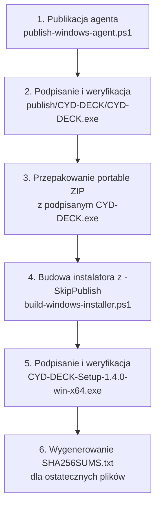

# Podpisywanie kodu Windows (Authenticode) i SmartScreen w CYD-DECK

Dokument określa architekturę podpisywania cyfrowego artefaktów Windows dla projektu **CYD-DECK**, uwarunkowania filtru Microsoft Defender SmartScreen oraz bezpłatną ścieżkę wydawniczą opartą o SignPath Foundation.

---

## 1. Status realizacji: Implemented vs BLOCKED

| Obszar | Status | Stan faktyczny |
|---|---|---|
| **Skrypt `scripts/sign-windows-artifacts.ps1`** | **IMPLEMENTED** | Obsługa plików `.exe`, `.dll`, `.ps1`, parametry `-VerifyOnly`, `-DryRun`, `-PassThru`, obsługa serwera znacznika czasu (Authenticode TSA) oraz ładowanie PFX z `EphemeralKeySet`. |
| **Ścisła walidacja kryptograficzna** | **IMPLEMENTED** | Wymaga `SignatureStatus.Valid` oraz obecności certyfikatu sygnatariusza. Stany `UnknownError`, `NotTrusted`, `HashMismatch` i `NotSigned` bezwzględnie przerywają wykonanie (fail-closed). Przy wskazanym TSA brak `TimeStamperCertificate` powoduje błąd. |
| **Testy jednostkowe sandbox** | **IMPLEMENTED** | `tests/sign-windows-artifacts.test.ps1`: **19/19 testów PASS** w PowerShell 5.1 i 7+. Testy działają w pamięci, bez dostępu do sieci i bez modyfikacji magazynów systemowych. |
| **Aktywne podpisywanie wydań (Live Signing)** | **BLOCKED** | Projekt **nie posiada obecnie certyfikatu Authenticode**. Testy na żywo nie były wykonywane. Podpisywanie wdrożeniowe pozostaje zablokowane do czasu złożenia wniosku przez maintainera i akceptacji przez fundację. |
| **Wymóg zerowych kosztów** | **CONFIRMED** | Projekt wyklucza płatne certyfikaty komercyjne. Jedyną dopuszczalną ścieżką jest bezpłatny program dla open-source. |
| **Status w `README.md`** | **POZOSTAJE `[ ]`** | Zadanie w Roadmap pozostaje nieodznaczone do czasu weryfikacji produkcyjnego podpisu na wydaniu. |

---

## 2. Microsoft Defender SmartScreen i certyfikaty

Zgodnie z dokumentacją techniczną Microsoft Learn (*SmartScreen reputation for Windows app developers*):

1. **Dwa sygnały reputacji:** SmartScreen sprawdza reputację skrótu SHA-256 konkretnego pliku oraz tożsamość certyfikatu Authenticode wydawcy.
2. **Certyfikaty samopodpisane (Self-Signed):** Nie pochodzą z zaufanego urzędu certyfikacji w *Microsoft Trusted Root Program*. System zgłasza dla nich status `UnknownError` lub `NotTrusted`, przez co certyfikat self-signed **nie rozwiązuje publicznego ostrzeżenia SmartScreen** dla użytkowników pobierających plik z sieci.
3. **Nowe wersje a reputacja:** Nawet certyfikat zaufany nie daje natychmiastowej gwarancji braku ekranu ostrzegawczego przy premierze nowego pliku binarnego. Każdy nowy skrót pliku buduje reputację poprzez bezpieczne pobrania i telemetrię Windows Defender, jednak certyfikat pozwala na akumulowanie zaufania do tożsamości wydawcy pomiędzy kolejnymi wydaniami.

---

## 3. Bezpłatna ścieżka: SignPath Foundation

W celu spełnienia wymogu **zerowych kosztów** przewidziano integrację z programem SignPath Foundation dla projektów open-source ([signpath.org/terms](https://signpath.org/terms)):

- **Status kandydata:** Licencja MIT i publiczne repozytorium kwalifikują projekt do złożenia wniosku. Kwalifikacja nie jest jednak automatyczna — fundacja rozpatruje wnioski uznaniowo po audycie źródeł i zależności.
- **Wymogi maintainera:** Wniosek może złożyć wyłącznie faktyczny maintainer (`Blankeuuu`). Wymagane jest włączenie MFA na koncie oraz konfiguracja polityki podpisywania (*Signing Policy*).
- **Manualne zatwierdzanie (Manual Approval):** Każde wydanie produkcyjne wymaga zatwierdzenia przez maintainera w portalu SignPath z użyciem MFA, co zapobiega podpisaniu nieautoryzowanego kodu w razie kompromitacji CI.
- **Brak fikcyjnej konfiguracji:** Do czasu formalnej akceptacji wniosku w repozytorium nie dodaje się fikcyjnych slugów, tokenów ani nie oznacza się projektu jako podpisanego przez fundację.

---

## 4. Architektura wydania i kolejność podpisywania

Podpis instalatora nie obejmuje automatycznie zawartego w nim programu. Podpisywanie obu artefaktów zapewnia weryfikowalną tożsamość wydawcy; wynik SmartScreen zależy także od reputacji. Proces składa się z następujących kroków:



### Krok 1: Publikacja Windows Agenta
```powershell
powershell -ExecutionPolicy Bypass -File scripts/publish-windows-agent.ps1 -OutputDirectory artifacts/release-v1.4.0
```

### Krok 2: Podpisanie i weryfikacja `CYD-DECK.exe`
Po podpisaniu pliku binarnego (przez SignPath lub certyfikatem wydawcy) następuje weryfikacja:
```powershell
powershell -ExecutionPolicy Bypass -File scripts/sign-windows-artifacts.ps1 `
    -ArtifactPaths "artifacts/release-v1.4.0/publish/CYD-DECK/CYD-DECK.exe" `
    -VerifyOnly
```

### Krok 3: Przepakowanie archiwum portable ZIP
Ponieważ pierwotne archiwum ZIP zostało spakowane przed podpisaniem pliku binarnego, należy je odświeżyć:
```powershell
Compress-Archive -Path "artifacts/release-v1.4.0/publish/CYD-DECK/*" `
    -DestinationPath "artifacts/release-v1.4.0/CYD-DECK-win-x64.zip" -Force
```

### Krok 4: Budowa instalatora z flagą `-SkipPublish`
Flaga `-SkipPublish` jest krytyczna — bez niej skrypt wykona ponowną kompilację i nadpisze podpisany wcześniej plik `CYD-DECK.exe`:
```powershell
powershell -ExecutionPolicy Bypass -File scripts/build-windows-installer.ps1 `
    -Version 1.4.0 -OutputDirectory artifacts/release-v1.4.0 -SkipPublish
```

### Krok 5: Podpisanie i weryfikacja instalatora
```powershell
powershell -ExecutionPolicy Bypass -File scripts/sign-windows-artifacts.ps1 `
    -ArtifactPaths "artifacts/release-v1.4.0/CYD-DECK-Setup-1.4.0-win-x64.exe" `
    -VerifyOnly
```

### Krok 6: Generowanie sum kontrolnych `SHA256SUMS.txt`
Sumy kontrolne muszą być wyliczone po ostatecznym podpisaniu wszystkich artefaktów. Format zgodny z parserami aktualizacji (`<hash>  <plik>`):
```powershell
Get-ChildItem -Path "artifacts/release-v1.4.0/*" -File |
    Where-Object { $_.Extension -in '.exe', '.zip', '.bin' } |
    Get-FileHash -Algorithm SHA256 |
    ForEach-Object { "$($_.Hash.ToLowerInvariant())  $(Split-Path -Leaf $_.Path)" } |
    Set-Content -LiteralPath "artifacts/release-v1.4.0/SHA256SUMS.txt" -Encoding UTF8
```

---

## 5. Obsługa skryptu weryfikacji i testów

### Weryfikacja integralności podpisu (`-VerifyOnly`)
```powershell
powershell -ExecutionPolicy Bypass -File scripts/sign-windows-artifacts.ps1 `
    -ArtifactPaths "artifacts/release-v1.4.0/CYD-DECK-Setup-1.4.0-win-x64.exe" `
    -VerifyOnly
```

### Tryb symulacji (`-DryRun`)
```powershell
powershell -ExecutionPolicy Bypass -File scripts/sign-windows-artifacts.ps1 `
    -ArtifactPaths "artifacts/release-v1.4.0/publish/CYD-DECK/CYD-DECK.exe" `
    -DryRun
```

### Uruchomienie testów automatycznych
```powershell
powershell -ExecutionPolicy Bypass -File tests/sign-windows-artifacts.test.ps1
```
Wynik: **19/19 testów PASS** w PowerShell 5.1 oraz 7+.
