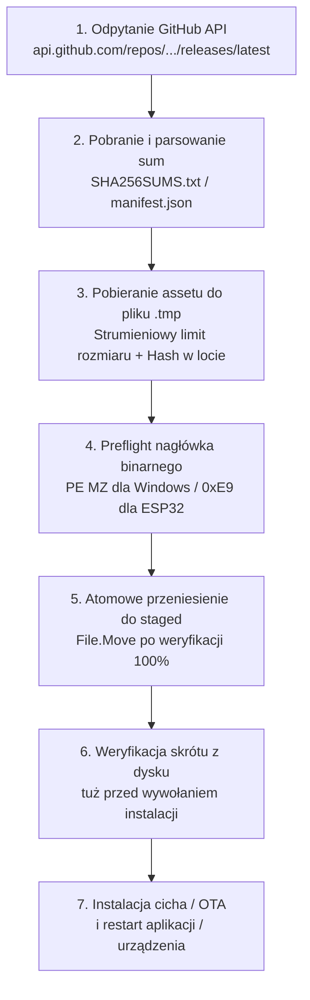

# Automatyczne aktualizacje aplikacji i firmware w CYD-DECK

Dokument opisuje architekturę systemu aktualizacji w aplikacji **CYD-DECK**, uwarunkowania bezpieczeństwa pobierania wydań z serwisu GitHub, mechanizmy weryfikacji integralności oraz procedury instalacji Agenta Windows i firmware ESP32 (ArduinoOTA).

---

## 1. Status realizacji: implementacja i regresje

> [!IMPORTANT]
> Implementacja i poprawki przeszły przegląd oraz testy regresyjne. README oznacza wykonanie kodu i regresji. Nie wykonano instalacji na żywo, flashowania urządzenia ani publikacji wydania zawierającego te zmiany.

| Obszar | Status | Stan faktyczny |
|---|---|---|
| **Klient wydań i walidacja bezpieczeństwa** | **IMPLEMENTED** | `UpdateReleaseClient`, `UpdateSecurityValidator`, `ChecksumsParser`, `UpdateStagingService`, `UpdateInstallerLauncher`, `UpdateManager`. |
| **Testy jednostkowe i integracyjne** | **PASS** | Lead: 136/136 asercji UpdateTests z fake HTTP/launcherem oraz pełny WindowsAgent.Tests PASS. Bez rzeczywistej instalacji lub OTA na urządzeniu. |
| **Cykl życia i review Leada** | **PASS** | StartMinimized bez otwarcia okna, Save/Discard/Cancel i błąd zapisu, bezpieczne przekierowania, generacje stagingu, ponowny SHA-256 oraz anulowanie stagingu firmware. |
| **Aktualizacja firmware przez Wi-Fi (ArduinoOTA)** | **IMPLEMENTED / LIVE PENDING** | Transfer ST7789 i potwierdzenie świeżej telemetrii z dokładną wersją; test urządzenia pozostaje manualny. |
| **Ograniczenie aktualizacji przez USB** | **UDOKUMENTOWANE** | Windows Agent nie posiada wbudowanego programatora `esptool`. Aktualizacja przewodowa USB odsyła użytkownika do oficjalnego narzędzia przeglądarkowego Web Installer. |
| **Status w `README.md`** | **`[x]` — kod i regresje** | Instalacja na żywo i wydanie nie zostały wykonane. |

---

## 2. Architektura i Kontrakt Bezpieczeństwa

Wszystkie operacje związane z pobieraniem i uruchamianiem kodu podlegają rygorystycznemu modelowi ochrony:



### 2.1. Źródło wydań i weryfikacja sum kontrolnych
- **Kanał wydań**: `https://api.github.com/repos/Blankeuuu/cyd-deck/releases/latest`. Dla kanału stabilnego ignorowane są wydania oznaczone jako `draft` lub `prerelease`.
- **Sprawdzanie**: jedna próba po 3 sekundach od startu aplikacji, także zminimalizowanej; następne sprawdzenie można wywołać w ustawieniach. Limit automatycznego sprawdzenia 4 h dotyczy bieżącej sesji; brak cyklicznego timera. Pobranie i instalacja wymagają działania użytkownika.
- **Wymóg sum kontrolnych**: Obsługiwane są formaty GNU `SHA256SUMS.txt` (`<hash>  <plik>`) oraz JSON `manifest.json`. Wydania pozbawione sum kontrolnych otrzymują status `ChecksumMissing` i są odrzucane (brak możliwości instalacji bez potwierdzenia integralności).

### 2.2. Whitelista domen i ochrona przed atakami
- **Dozwolone hosty**: Wyłącznie `github.com` oraz CDN `objects.githubusercontent.com` po protokole HTTPS (maksymalnie 5 bezpiecznych skoków przekierowań).
- **Sanityzacja nazw**: Odrzucanie separatorów katalogów (`/`, `\`), sekwencji `..` (ochrona przed Path Traversal) oraz znaków kontrolnych.
- **Ścisłe powiązanie z wersją (*Exact Version Binding*)**: Nazwy plików muszą precyzyjnie odpowiadać wzorcom powiązanym z numerem wersji z tagu:
  - Instalator Windows: `^CYD-DECK-Setup-(?<ver>[0-9]+\.[0-9]+\.[0-9]+.*)-win-x64\.exe$`
  - Firmware ESP32: `^firmware-ST7789-(?<ver>[0-9]+\.[0-9]+\.[0-9]+.*)\.bin$`
- **Ochrona partycji ESP32**: Bezwzględne odrzucanie obrazów pełnych (`-full.bin`, `.full.bin`), które nadpisałyby adres `0x0`, niszcząc bootloader i partycję NVS, oraz binarek dla innych wyświetlaczy (np. `ili9341`).

### 2.3. Przygotowanie atomowe (Staging)
- Pobieranie do pliku tymczasowego `.tmp` z kontrolą limitu rozmiaru (max 300 MB dla instalatora, max 1.93 MB dla partycji OTA ESP32).
- Preflight validation sygnatur binarnych:
  - Instalator Windows: obecność nagłówka PE `MZ` (`0x4D, 0x5A`) oraz rozmiar >= 1024 B.
  - Firmware ESP32: bajt sygnatury magic `0xE9`.
- Atomowe przeniesienie (`File.Move`) do katalogu przygotowawczego dopiero po pomyślnej walidacji skrótu i sygnatury.
- **Powtórna weryfikacja skrótu**: Przed uruchomieniem instalatora następuje ponowne obliczenie sumy SHA-256 z dysku w celu ochrony przed atakami typu file-tampering.
- Nowe sprawdzenie unieważnia przygotowane pakiety oraz wyniki wcześniejszych pobrań. Firmware ma dodatkowo SHA-256 obrazu w pamięci przed rozpoczęciem komunikacji OTA, również gdy plik zmieniono po otwarciu dialogu.

---

## 3. Procedura aktualizacji Windows Agenta

1. **Uruchomienie instalatora Inno Setup**:
   Aplikacja uruchamia pobrany instalator z flagami instalacji cichej:
   ```cmd
   CYD-DECK-Setup-{wersja}-win-x64.exe /SILENT /SUPPRESSMSGBOXES /CLOSEAPPLICATIONS /NORESTART
   ```
2. **Zachowanie danych użytkownika**:
   Instalator aktualizuje wyłącznie pliki programu w `%LOCALAPPDATA%\Programs\CYD-DECK`. Konfiguracja skrótów, dane parowania oraz ustawienia zasobnika systemowego w `%LOCALAPPDATA%\StreamDeckAgent` pozostają nienaruszone.
3. **Restart aplikacji**:
   Po zakończeniu instalacji instalator automatycznie uruchamia zaktualizowany plik `{app}\CYD-DECK.exe`.
   `/NORESTART` blokuje restart systemu Windows; uruchomienie aplikacji pochodzi z sekcji `[Run]`, bez `skipifsilent`. Zachowanie wynika z [parametrów Inno Setup](https://jrsoftware.org/ishelp/topic_setupcmdline.htm) i [sekcji Run](https://jrsoftware.org/ishelp/topic_runsection.htm); nie wykonano testu instalacji na żywo.
4. **Niezapisane zmiany**: Save czeka na skuteczny zapis, Discard porzuca draft, Cancel lub błąd zapisu blokuje instalację.

---

## 4. Procedura aktualizacji Firmware ESP32 (Transport Wi-Fi vs USB)

### 4.1. Połączenie Wi-Fi (ArduinoOTA)
- W przypadku aktywnego połączenia sieciowego z CYD Display, Agent przesyła przygotowany plik `.bin` bezpośrednio na adres IP urządzenia za pośrednictwem protokołu ArduinoOTA (port domyślny: 3232).
- Wymagane jest podanie hasła konfiguracyjnego urządzenia, ustalonego podczas onboardingu.
- **Ochrona przed ucegleniem**: Okno dialogowe blokuje możliwość zamknięcia w trakcie trwania transferu firmware.
- **Weryfikacja telemetrii**: Po zrestartowaniu urządzenia Agent oczekuje na świeży raport telemetrii ze zaktualizowanym numerem wersji.

### 4.2. Połączenie wyłącznie przez kabel USB
- Windows Agent nie zawiera wbudowanego programatora sprzętowego `esptool`.
- W przypadku wykrycia połączenia wyłącznie przewodowego (brak IP Wi-Fi w telemetrii), funkcja instalacji OTA zostaje zablokowana.
- Interfejs wyświetla czytelną informację w języku polskim oraz kieruje użytkownika do oficjalnego narzędzia w przeglądarce:
  **[CYD-DECK Web Installer](https://blankeuuu.github.io/cyd-deck/web-installer/)**.

---

## 5. Podsumowanie i dalsze kroki

Przed wydaniem pozostaje autoryzowany test instalacji i restartu aplikacji oraz OTA na fizycznym ST7789. Podpis Authenticode wydań pozostaje osobno zablokowany na uzyskaniu darmowej usługi/certyfikatu; patrz [przewodnik podpisywania](code-signing-smartscreen.md).
